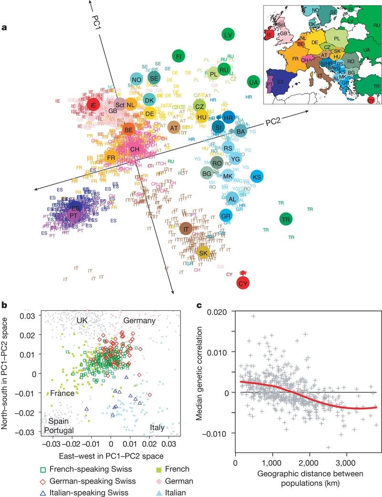

```{r}
#| label: setup
source("_setup.R")
set.seed(641)
```

# What is population structure?

## Population structure in one slide

- Individuals form **groups** with **different allele frequencies**
- Causes: limited gene flow (distance, barriers), drift, selection, and the **breeder's choice of crosses**
- Humans: genetic ancestry **follows geography**, from continents (Rosenberg et al. 2002) down to countries in Europe (Novembre et al. 2008)

<!-- TODO: incluir aqui o exemplo do Rodrigo -->

::: notes
Estrutura populacional significa que os genótipos não estão distribuídos ao
acaso: há grupos de indivíduos que compartilham frequências alélicas mais
entre si do que com o resto. Ela aparece sempre que os cruzamentos não são
aleatórios: distância geográfica, barreiras físicas, deriva genética em grupos
pequenos, seleção e, em plantas e animais, o melhorista decidindo quem cruza
com quem. Em humanos, os exemplos clássicos são Rosenberg et al. (2002), em
que o STRUCTURE separa 52 populações do mundo em grupos continentais, e
Novembre et al. (2008), em que uma PCA dos genótipos de europeus reproduz o
mapa da Europa.
:::

## Human example: genes mirror geography

{fig-align="center"}

::: destaque
Novembre et al. 2008: the PCA redraws the map
:::

::: notes
Simulação inspirada em Novembre et al. (2008). As pessoas vivem num mapa;
cada cor é uma região. As frequências alélicas mudam aos poucos com a
distância, porque as pessoas tendem a ter filhos com vizinhos. Uma PCA feita
só com os genótipos, sem nenhuma informação de localização, coloca os
indivíduos no mesmo arranjo do mapa. Novembre et al. encontraram exatamente
isso com dados reais de cerca de 1.400 europeus.
:::

## Populations do not mate at random

```{r}
#| label: g-panmixia
#| fig-height: 6.4
n <- 160
pan <- data.table(x = runif(n, -1, 1), y = runif(n, -1, 1),
                  alelo = sample(c("A", "a"), n, TRUE), cenario = "Panmixia")
est <- rbind(
  data.table(x = runif(n / 2, -1, -0.15), y = runif(n / 2, -1, 1),
             alelo = sample(c("A", "a"), n / 2, TRUE, c(0.85, 0.15))),
  data.table(x = runif(n / 2, 0.15, 1), y = runif(n / 2, -1, 1),
             alelo = sample(c("A", "a"), n / 2, TRUE, c(0.15, 0.85)))
)[, cenario := "Structured"]
d <- rbind(pan, est)[, cenario := factor(cenario, c("Panmixia", "Structured"))]

ggplot(d, aes(x, y, colour = alelo)) +
  geom_point(size = 5) +
  geom_vline(data = data.table(cenario = factor("Structured",
                                                levels(d$cenario)), x = 0),
             aes(xintercept = x), linewidth = 2, colour = "grey40") +
  facet_wrap(~ cenario) +
  scale_colour_manual(values = cor_alelo, name = "allele") +
  labs(x = NULL, y = NULL) +
  theme(axis.text = element_blank(), panel.grid = element_blank(),
        strip.text = element_text(size = rel(1.2)))
```

::: destaque
Subpopulations → different allele frequencies
:::

::: notes
Numa população panmítica, qualquer indivíduo pode cruzar com qualquer outro,
e as frequências alélicas são as mesmas em todo lugar. Quando há barreiras
(geografia, seleção, o melhorista escolhendo os cruzamentos), cada
subpopulação deriva para frequências próprias. Isso é estrutura: os genótipos
não estão distribuídos ao acaso.
:::

## Why does it matter?

```{r}
#| label: g-importancia
#| fig-height: 5.8
# Grão de milho desenhado como uma superelipse; o dent tem a depressão no topo
grao <- function(tipo, cx) {
  t <- seq(0, 2 * pi, length.out = 400)
  x <- 0.42 * sign(cos(t)) * abs(cos(t))^0.7
  y <- 0.55 * sign(sin(t)) * abs(sin(t))^0.9
  if (tipo == "dent") {
    x <- x * 1.1
    y <- ifelse(y > 0, y - 0.18 * exp(-(x / 0.18)^2) * (y / 0.55), y)
  } else {
    y <- y * 0.92
  }
  data.table(x = x + cx, y = y, tipo = tipo)
}
graos <- rbind(grao("dent", 0), grao("flint", 1.3))
p_melhoramento <- ggplot(graos, aes(x, y, group = tipo, fill = tipo)) +
  geom_polygon(colour = "grey25", linewidth = 1) +
  annotate("text", x = c(0, 1.3), y = -0.8, label = c("dent", "flint"),
           size = 8) +
  scale_fill_manual(values = c(dent = "#F2C94C", flint = "#E67E22"),
                    guide = "none") +
  coord_equal(clip = "off") + tema_vazio +
  labs(title = "Breeding", subtitle = "heterotic groups")

# Vicariância: um rio separa uma população em duas
v <- rbind(data.table(x = runif(70, -1, -0.15), y = runif(70, -1, 1), pop = "a"),
           data.table(x = runif(70, 0.15, 1), y = runif(70, -1, 1), pop = "b"))
rio <- data.table(y = seq(-1.1, 1.1, length.out = 100))[, x := 0.07 * sin(y * 9)]
p_biologia <- ggplot(v, aes(x, y)) +
  geom_path(data = rio, colour = "#4A90D9", linewidth = 5) +
  geom_point(aes(colour = pop), size = 3) +
  scale_colour_manual(values = c(a = "#7B3294", b = "#008837"), guide = "none") +
  coord_equal() + tema_vazio +
  labs(title = "Biology", subtitle = "vicariance → speciation")

# Manhattan plot simulado: picos que podem ser só estrutura
m <- data.table(chr = rep(1:10, each = 300))[, pos := seq_len(.N), by = chr]
m[, p := -log10(runif(.N))]
m[chr %in% c(2, 5, 8), p := p + 9 * exp(-((pos - 150) / 12)^2)]
m[, x := (chr - 1) * 330 + pos]
p_gwas <- ggplot(m, aes(x, p, colour = factor(chr %% 2))) +
  geom_point(size = 0.8) +
  geom_hline(yintercept = 7.3, linetype = "dashed", colour = "#B22222") +
  scale_colour_manual(values = c("grey30", "grey65"), guide = "none") +
  scale_x_continuous(breaks = NULL) +
  labs(x = "chromosome", y = "−log10 p", title = "GWAS",
       subtitle = "spurious peaks") +
  theme(panel.grid = element_blank(),
        plot.subtitle = element_text(colour = "grey30"))

p_melhoramento + p_biologia + p_gwas
```

::: notes
Três motivos. Melhoramento: os híbridos de milho vêm do cruzamento de dois
grupos heteróticos (aqui, grãos dent e flint); saber a qual grupo uma linha
pertence diz com quem cruzá-la. Biologia: quando uma barreira (um rio, uma
montanha) divide uma população, as duas metades divergem, e isso pode levar à
especiação (vicariância); a estrutura registra essa história. GWAS: em
estudos de associação, ignorar a estrutura produz picos que não são reais
(falsos positivos), como mostra o próximo slide.
:::

## Spurious association: type I error

```{r}
#| label: g-associacao-falsa
#| fig-height: 6.4
n <- 200
d <- rbind(
  data.table(pop = "Population 1", snp = rbinom(n, 2, 0.8),
             altura = rnorm(n, 2.4, 0.12)),
  data.table(pop = "Population 2", snp = rbinom(n, 2, 0.2),
             altura = rnorm(n, 2.0, 0.12))
)
ggplot(d, aes(snp, altura)) +
  geom_jitter(aes(colour = pop), width = 0.15, size = 2.5, alpha = 0.6) +
  geom_smooth(aes(colour = pop), method = "lm", se = FALSE, linewidth = 1.5,
              linetype = "dashed") +
  geom_smooth(method = "lm", se = FALSE, colour = "black", linewidth = 2.5) +
  scale_colour_manual(values = c("#7B3294", "#008837"), name = NULL) +
  scale_x_continuous(breaks = 0:2, labels = c("aa", "Aa", "AA")) +
  labs(x = "SNP genotype", y = "plant height (m)")
```

::: destaque
The SNP has no effect: the difference comes from the population
:::

::: notes
Simulação: o SNP não afeta a altura. A população 1 é mais alta e tem mais o
alelo A. Juntando tudo (linha preta), parece que o alelo A aumenta a altura.
Dentro de cada população (linhas tracejadas), não há efeito nenhum. Por isso
o GWAS corrige pela estrutura (matriz Q do STRUCTURE ou PCs como
covariáveis).
:::

# The data: CornFed panels

## Dent × Flint: two heterotic groups

```{r}
#| label: g-heterose
#| fig-width: 10
#| fig-height: 5.6
diagrama(
  data.table(id = c("D", "F", "H"), x = c(0, 0, 4.2), y = c(1, -1, 0),
             rotulo = c("Dent\nCorn Belt (USA)\nB73, Mo17",
                        "Flint\nEurope\nearly, cold-tolerant",
                        "Hybrid\nheterosis"),
             cor = c(cor_pool[["Dent"]], cor_pool[["Flint"]], "#FF7F00")),
  data.table(de = c("D", "F"), para = c("H", "H")),
  largura = 3.4, altura = 1.6)
```

::: notes
Os dois grupos foram mantidos separados por décadas para maximizar a heterose
no híbrido dent × flint. Esperamos que esta seja a divisão mais forte nos
dados (K = 2).
:::

## One central line × 10–11 founders (+ 3 cross-pool families)

```{r}
#| label: g-desenho
#| fig-height: 6.6
desenho <- data.table(
  pool = rep(c("Dent", "Flint"), c(11, 13)),
  central = rep(c("F353", "UH007"), c(11, 13)),
  familia = c("CFD01", "CFD02", "CFD03", "CFD04", "CFD05", "CFD06", "CFD07",
              "CFD09", "CFD10", "CFD11", "CFD12",
              "CFF01", "CFF02", "CFF03", "CFF04", "CFF05", "CFF06", "CFF07",
              "CFF08", "CFF09", "CFF10", "CFF12", "CFF13", "CFF15"),
  fundadora = c("UH007", "B73", "D06", "D09", "EC169", "F252", "F618", "Mo17",
                "UH250", "UH304", "W117",
                "F353", "B73", "D152", "EC49A", "EP44", "EZ5", "F03802", "F2",
                "F283", "F64", "UH006", "UH009", "DK105")
)
desenho[, ang := 2 * pi * (seq_len(.N) - 1) / .N, by = pool]
desenho[, `:=`(x = cos(ang), y = sin(ang))]
# fundadora do outro pool: são as famílias "misturadas"
desenho[, outro_pool := familia %in% c("CFD01", "CFF01", "CFF02")]
centros <- unique(desenho[, .(pool, central)])

ggplot(desenho) +
  geom_segment(aes(x = 0, y = 0, xend = x, yend = y, colour = outro_pool),
               linewidth = 1.2) +
  geom_label(aes(x * 1.18, y * 1.18, label = fundadora, colour = outro_pool),
             size = 6, label.size = 0) +
  geom_label(data = centros, aes(0, 0, label = central, fill = pool),
             colour = "white", size = 8, fontface = "bold") +
  facet_wrap(~ pool) +
  scale_colour_manual(values = c(`FALSE` = "grey35", `TRUE` = "#FF7F00"),
                      labels = c("founder from the same pool",
                                 "founder from the other pool"), name = NULL) +
  scale_fill_manual(values = cor_pool, guide = "none") +
  coord_equal(clip = "off") +
  theme_void(base_size = 24) +
  theme(legend.position = "bottom",
        strip.text = element_text(face = "bold", size = rel(1.2)))
```

::: notes
Cada família vem do cruzamento da linha central do pool (F353 no dent, UH007
no flint) com uma fundadora. Por isso as famílias de um pool são meio-irmãs.
Três famílias têm pais dos dois pools (em laranja): CFD01 e CFF01 são o
cruzamento entre as duas linhas centrais, e CFF02 tem B73 (dent) como
fundadora. São os nossos controles: devem aparecer com ~50% de cada pool.

CONTAGEM: 10 fundadoras dent e 11 flint do próprio pool (como no Lehermeier:
"10 diverse dent founder lines", "11 flint founder lines"), mais 3 famílias
entre pools. Nos nossos dados: 11 famílias dent, 13 flint, 2.267 DH e 23
parentais. Os nomes: CF = CornFed (o projeto), D = painel dent, F = painel
flint, número = a família; CFD11-023 é a DH 23 da família 11. Faltam a CFD08
(F353 × F98902: está nos fenótipos, mas não no GEO), a CFF11 e a CFF14.

FAMÍLIAS DENT (central F353, INRA, França). SM = simple matching da
fundadora com a central (Lehermeier 2014, Tabela 1): quanto mais alto, mais
parecida.
  CFD01  UH007 (central flint)   Hohenheim       86 DH   —
  CFD02  B73                     Iowa, EUA       73 DH   SM 0,608
  CFD03  D06                     Hohenheim      103 DH   SM 0,642
  CFD04  D09                     Hohenheim      105 DH   SM 0,668
  CFD05  EC169                   CIAM, Espanha   77 DH   SM 0,617
  CFD06  F252                    INRA, França   105 DH   SM 0,671
  CFD07  F618                    INRA, França   108 DH   SM 0,645
  CFD09  Mo17                    Missouri, EUA   63 DH   SM 0,627
  CFD10  UH250                   Hohenheim       99 DH   SM 0,634
  CFD11  UH304                   Hohenheim       86 DH   SM 0,765 (a mais alta)
  CFD12  W117                    Wisconsin, EUA 100 DH   SM 0,625

FAMÍLIAS FLINT (central UH007, Universidade de Hohenheim, Alemanha):
  CFF01  F353 (central dent)     INRA, França    99 DH   —
  CFF02  B73 (fundadora dent)    Iowa, EUA      120 DH   —
  CFF03  D152                    Hohenheim      112 DH   SM 0,749
  CFF04  EC49A                   CIAM, Espanha   53 DH   SM 0,656
  CFF05  EP44                    CSIC, Espanha   34 DH   SM 0,615
  CFF06  EZ5                     CSIC, Espanha   50 DH   SM 0,613
  CFF07  F03802                  INRA, França   129 DH   SM 0,753
  CFF08  F2                      INRA, França    77 DH   SM 0,723
  CFF09  F283                    INRA, França   134 DH   SM 0,716
  CFF10  F64                     INRA, França   108 DH   SM 0,621
  CFF12  UH006                   Hohenheim      114 DH   SM 0,791
  CFF13  UH009                   Hohenheim      117 DH   SM 0,815 (a mais alta)
  CFF15  DK105                   Hohenheim      115 DH   SM 0,738
(Procedência = de onde vieram as sementes, segundo os metadados do GEO.
EC169 está como flint no GEO, mas é fundadora dent; reclassificamos.)

LIGAÇÃO COM OS RESULTADOS: quanto mais a fundadora se parece com a central,
mais a família inteira se parece com a central. As quatro famílias flint de
SM mais baixo (CFF04, 05, 06 e 10; três com fundadoras espanholas) são as
que aparecem com um pouco de "dent" no K = 2 global. CFF12 e CFF13 (SM mais
alto) ficam inteiras no grupo da UH007. No dent, CFD11 (F353 × UH304, ambas
de origem Iodent) é a família mais homogênea e ganha um grupo próprio em
K = 3.
:::

## Doubled haploid (DH) lines

```{r}
#| label: g-dh
#| fig-width: 13
#| fig-height: 4.4
diagrama(
  data.table(id = c("C", "Fu", "F1", "H", "DH"),
             x = c(0, 0, 3.6, 7.6, 11.6), y = c(0.9, -0.9, 0, 0, 0),
             rotulo = c("Central", "Founder", "F1", "Haploid\n(n)",
                        "DH (2n)\nhomozygous"),
             cor = c("grey92", "grey92", "grey60", "grey60", "#1F3A5F")),
  data.table(de = c("C", "Fu", "F1", "H"), para = c("F1", "F1", "H", "DH"),
             rotulo = c("", "", "haploid\ninducer", "colchicine"),
             lx = c(NA, NA, 5.6, 9.6), ly = c(NA, NA, 0.95, 0.95)),
  largura = 2.4, altura = 1.3, tamanho = 6.5, tamanho_rotulo = 5.5)
```

::: destaque
One meiosis · 50% central + 50% founder
:::

::: notes
A planta F1 é polinizada por um indutor de haploidia; os cromossomos dos
embriões haploides são duplicados com colchicina. Resultado: linhas
totalmente homozigotas em uma geração. Como houve uma única meiose (na F1),
cada DH é um mosaico de grandes blocos da linha central e da fundadora. Isso
vai aparecer no LD e no STRUCTURE.
:::

## The data

```{r}
#| label: g-numeros
#| fig-height: 4
numeros(c("2,290", "24", "23", "56,110"),
        c("genotyped\nlines", "DH\nfamilies", "parents",
          "SNPs\n(50K chip)"))
```

GEO **GSE50558** · Bauer et al. 2013 · Lehermeier et al. 2014

::: notes
A matriz do GEO tem os dois pools juntos. Lehermeier et al. (2014) analisaram
os painéis dent e flint separadamente e também em conjunto (34.116 SNPs na
análise conjunta); fazemos o mesmo: um conjunto "global" (dent + flint) e um
conjunto por pool. Lehermeier usou 10 famílias dent e 11 flint; o GEO tem 3 a
mais (CFD01, CFF01, CFF02), os cruzamentos entre pools, que usamos como
controles.
:::

# From SNPs to clean data

## The chip reads two alleles: A and B

```{r}
#| label: g-codigos
#| fig-height: 5.8
cod <- fread(file.path(dir_comp, "codigos_genotipo.tsv"))
cod[, codigo := factor(codigo, c("AA", "BB", "AB", "NC"),
                       c("AA", "BB", "AB", "no call"))]
cod[, tipo := factor(tipo, c("Parental", "DH"), c("Parents", "DH"))]
ggplot(cod, aes(codigo, prop, fill = codigo == "AB")) +
  geom_col(width = 0.7) +
  geom_text(aes(label = scales::percent(prop, 0.1)),
            vjust = -0.3, size = 7) +
  facet_wrap(~ tipo) +
  scale_fill_manual(values = c(`FALSE` = "grey60", `TRUE` = "#B22222"),
                    guide = "none") +
  scale_y_continuous(labels = scales::percent, limits = c(0, 0.55)) +
  labs(x = NULL, y = NULL)
```

::: destaque
DH almost without AB → heterozygote = error → missing data
:::

::: notes
SNP = uma posição do genoma com dois alelos. O chip Illumina chama AA, AB ou
BB. Linhas DH e parentais endogâmicos deveriam ser 100% homozigotos; o pouco
de AB que aparece (0,3% nas DH) é erro de chamada ou heterozigose residual.
Por isso tratamos AB como dado faltante.
:::

## PLINK: the Swiss army knife for SNPs

:::: {.columns}
::: {.column width="45%"}
- file formats
- filters (QC)
- LD and pruning
- PCA, F~ST~
:::
::: {.column width="55%"}
Built for **humans**: 22 autosomes + X, Y

**Maize**: 10 chromosomes, no sex chromosomes

```r
c("--chr-set", "10", "no-xy")
```
:::
::::

::: notes
O PLINK é o programa padrão para manipular dados de SNP, e é com ele que
fazemos todas as etapas de filtragem a seguir. Por padrão ele supõe o genoma
humano e trataria os cromossomos de outro jeito (por exemplo, os
cromossomos sexuais). --chr-set 10 no-xy diz que são 10 autossomos e nenhum
cromossomo sexual. Chamamos o PLINK de dentro do R com system2(), na função
rodar_plink(), para todo o fluxo ficar num script só.
:::

## SNPs have errors: filtering

:::: {.columns}
::: {.column width="55%"}
```{r}
#| label: g-funil
#| fig-width: 8
#| fig-height: 6
funil <- fread(file.path(dir_comp, "funil_cq.tsv"))[1:5]
funil[, etapa := c("SNP chip", "With position", "GenTrain ≥ 0.7",
                   "Call rate ≥ 90%", "MAF ≥ 1%")]
funil[, etapa := factor(etapa, rev(etapa))]
funil[, removidos := shift(snps) - snps]
ggplot(funil, aes(snps, etapa)) +
  geom_col(fill = "#1F3A5F", width = 0.7) +
  geom_text(aes(label = format(snps, big.mark = ",", trim = TRUE)), hjust = 1.1,
            colour = "white", size = 7, fontface = "bold") +
  geom_text(aes(label = ifelse(is.na(removidos), "",
                               paste0("− ", format(removidos, big.mark = ",",
                                                   trim = TRUE)))),
            hjust = -0.15, size = 6, colour = "#B22222") +
  scale_x_continuous(expand = expansion(c(0, 0.35)), breaks = NULL) +
  labs(x = NULL, y = NULL)
```
:::
::: {.column width="45%"}
```r
rodar_plink(
  "--bfile", "cornfed_bruto",
  "--exclude",
    "gentrain_baixo.txt",
  "--remove",
    "dh_faltantes.txt",
  "--geno", "0.1",
  "--maf",  "0.01",
  "--make-bed",
  "--out", "cornfed_cq")
```

```
33430 variants and
2269 samples pass
```
:::
::::

::: notes
GenTrain: nota de qualidade do agrupamento das intensidades no chip (SNPs com
nota < 0,7 têm chamadas pouco confiáveis; ficam listados em
gentrain_baixo.txt e saem com --exclude). Call rate (--geno 0.1): SNP sem
genótipo em mais de 10% das amostras é removido. MAF (--maf 0.01): SNP quase
monomórfico não informa sobre estrutura e é mais sujeito a erro. Também
removemos 21 DH com mais de 10% de dados faltantes (--remove). Mesmos
critérios de Lehermeier et al. 2014 (eles ficaram com 34.116 SNPs; nós com
33.430).
:::


## Linkage disequilibrium (LD)

```{r}
#| label: g-ld
#| fig-height: 6.2
ld <- fread(file.path(dir_comp, "ld_decaimento.tsv"))
ld[, grupo := factor(grupo, c("DH dent", "DH flint", "Parentais"),
                     c("DH dent", "DH flint", "Parents"))]
ggplot(ld[distancia_mb <= 10], aes(distancia_mb, r2, colour = grupo)) +
  geom_hline(yintercept = 0.2, linetype = "dashed", linewidth = 1) +
  annotate("text", x = 10, y = 0.215, label = "pruning threshold (r² = 0.2)",
           hjust = 1, vjust = 0, size = 7) +
  geom_line(linewidth = 2) +
  scale_colour_manual(values = c(`DH dent` = cor_pool[["Dent"]],
                                 `DH flint` = cor_pool[["Flint"]],
                                 Parents = "grey40"), name = NULL) +
  labs(x = "distance between SNPs (Mb)", y = "mean r²")
```

::: notes
LD = associação entre alelos de locos próximos: eles são herdados juntos. O
r² mede isso (0 = independentes, 1 = sempre juntos). Nas DH o LD é maior e
cai devagar com a distância, porque houve uma única meiose. O STRUCTURE
supõe locos independentes dentro de cada grupo; SNPs em LD repetem a mesma
informação várias vezes e deixam o resultado confiante demais.
:::

## LD pruning

:::: {.columns}
::: {.column width="55%"}
```{r}
#| label: g-poda
#| fig-width: 8
#| fig-height: 6
# SNPs que entraram no STRUCTURE no cluster (todas as amostras)
plano <- unique(fread(file.path(dir_prod, "evanno.tsv"))[
  , .(etapa = conjunto, snps = loci)])
poda <- rbind(fread(file.path(dir_comp, "funil_cq.tsv"))[5, .(etapa, snps)],
              plano)
rotulos_poda <- c("after\nfilters", "global\n(dent + flint)", "dent", "flint")
poda[, etapa := factor(rotulos_poda[
  match(etapa, c("MAF ≥ 1%", "global", "dent", "flint"))], rotulos_poda)]
ggplot(poda, aes(etapa, snps, fill = etapa)) +
  geom_col(width = 0.7) +
  geom_text(aes(label = format(snps, big.mark = ",")), vjust = -0.3, size = 8,
            fontface = "bold") +
  scale_fill_manual(values = c("#1F3A5F", "grey40", cor_pool[["Dent"]],
                               cor_pool[["Flint"]]), guide = "none") +
  scale_y_continuous(breaks = NULL, expand = expansion(c(0, 0.15))) +
  labs(x = NULL, y = NULL)
```
:::
::: {.column width="45%"}
```r
# window 50, step 5,
# r² > 0.2 → one goes
rodar_plink(
  "--bfile", "cornfed_cq",
  "--keep",  "dent.txt",
  "--maf",   "0.01",
  "--geno",  "0.1",
  "--indep-pairwise",
    "50", "5", "0.2",
  "--out",   "dent")
```
:::
::::

::: notes
A poda anda pelo genoma em janelas de 50 SNPs (passo de 5). Dentro da
janela, para cada par com r² > 0,2, um SNP é removido. Ela é feita
separadamente em cada conjunto (global, dent, flint), sempre a partir dos
mesmos 33.430 SNPs; por isso as três listas são, em grande parte, SNPs
diferentes e não se somam. Dentro dos pools sobram menos SNPs porque muitos
ficam fixos e porque o LD é mais forte: todas as DH de um pool compartilham a
mesma linha central. Bônus: o STRUCTURE fica muito mais rápido.
:::

# STRUCTURE

## The idea of the model

```{r}
#| label: g-modelo
#| fig-width: 11
#| fig-height: 4.6
diagrama(
  data.table(id = c("G1", "G2", "I"), x = c(0, 0, 5), y = c(1, -1, 0),
             rotulo = c("Group 1\nfrequencies p1", "Group 2\nfrequencies p2",
                        "Individual\nQ = 0.7 | 0.3"),
             cor = c(cores[["Cluster2"]], cores[["Cluster1"]], "grey35")),
  data.table(de = c("G1", "G2"), para = c("I", "I"),
             rotulo = c("70%", "30%"),
             lx = c(2.5, 2.5), ly = c(1.05, -1.05)),
  largura = 3.2, altura = 1.3, tamanho_rotulo = 7)
```

::: destaque
K groups in Hardy-Weinberg · Q = fraction from each group
:::

::: notes
O STRUCTURE (Pritchard et al. 2000) supõe que existem K populações
ancestrais, cada uma com suas frequências alélicas, em equilíbrio de
Hardy-Weinberg e de ligação. Ele procura a divisão dos indivíduos (ou de
partes do genoma deles, no modelo com mistura) que deixa cada grupo o mais
próximo possível desse equilíbrio. Estima ao mesmo tempo as frequências
alélicas de cada grupo (P) e as proporções de cada indivíduo (Q). No exemplo,
70% do genoma do indivíduo vem do grupo 1 e 30% do grupo 2.
:::

## How STRUCTURE estimates P and Q

:::: {.columns}
::: {.column width="58%"}
```{r}
#| label: g-brinquedo
#| fig-width: 8.5
#| fig-height: 6
# Exemplo de brinquedo: 4 linhas, 4 SNPs, K = 2, uma cópia por SNP
brinquedo <- CJ(linha = c("A", "B", "C", "D"), snp = 1:4)
brinquedo[, alelo := c(1, 1, 1, 1,  1, 1, 1, 2,  2, 2, 2, 2,  2, 2, 1, 2)]
brinquedo[, grupo := c("G1", "G1", "G1", "G1",  "G1", "G1", "G1", "G2",
                       "G2", "G2", "G2", "G2",  "G2", "G2", "G1", "G2")]
brinquedo <- rbind(
  brinquedo[, .(linha, snp, alelo, preenchimento = "dados", painel = "data (observed)")],
  brinquedo[, .(linha, snp, alelo, preenchimento = grupo, painel = "Z (current guess)")])
brinquedo[, painel := factor(painel, c("data (observed)", "Z (current guess)"))]
ggplot(brinquedo, aes(snp, linha, fill = preenchimento)) +
  geom_tile(colour = "white", linewidth = 2) +
  geom_text(aes(label = alelo,
                colour = preenchimento == "dados"), size = 10, fontface = "bold") +
  facet_wrap(~ painel) +
  scale_fill_manual(values = c(dados = "grey90", G1 = cores[["Cluster2"]],
                               G2 = cores[["Cluster1"]]),
                    breaks = c("G1", "G2"), name = NULL) +
  scale_colour_manual(values = c(`TRUE` = "black", `FALSE` = "white"),
                      guide = "none") +
  scale_x_continuous(breaks = 1:4, labels = paste0("SNP", 1:4),
                     position = "top") +
  scale_y_discrete(limits = rev) +
  labs(x = NULL, y = NULL) +
  theme(panel.grid = element_blank())
```
:::
::: {.column width="42%"}
**P** from Z (SNP 3, allele 1)

| | count | p |
|---|---|---|
| G1 | 3 of 3 | (3+1)/(3+2) = 0.80 |
| G2 | 0 of 1 | (0+1)/(1+2) = 0.33 |

**Q** from Z (copies in G1)

| A | B | C | D |
|---|---|---|---|
| 1.00 | 0.75 | 0.00 | 0.25 |
:::
::::

::: destaque
Start: Z at random · Z → P and Q → Z → … (150,000 times)
:::

::: notes
Exemplo de brinquedo: 4 linhas, 4 SNPs, K = 2, e uma cópia por SNP (como se
fossem haploides). À esquerda, os dados: só o alelo de cada linha em cada
SNP. É tudo o que o STRUCTURE observa.

O que ele precisa descobrir é o Z: de qual grupo veio cada cópia de alelo
(as cores). No começo o Z é sorteado ao acaso; a figura mostra um Z
"atual", depois de algumas iterações.

Com o Z, ele calcula as outras duas peças:
- P, a frequência do alelo dentro de cada grupo: no SNP 3, as três cópias
  que estão em G1 (A, B e D) são do alelo 1, e a única em G2 (C) é do alelo
  2. Ele soma uma "cópia fictícia" de cada alelo (a priori), para a
  frequência nunca dar 0 ou 1: p = (3+1)/(3+2) = 0,80 em G1 e
  (0+1)/(1+2) = 0,33 em G2.
- Q, a fração de cada linha em cada grupo: basta contar as cópias da linha
  em cada cor. A tem 4 de 4 em G1 (1,00); B, 3 de 4 (0,75); C, nenhuma (0);
  D, 1 de 4 (0,25).
Na verdade o programa sorteia P e Q em torno desses valores, mas a ideia é
essa. Ou seja: P e Q não vêm prontos dos dados; dependem de quem está em
cada grupo, que é o Z.
:::

## Then Z is re-drawn from P and Q

Each copy: chance of group k ∝ **q**(line, k) × **p**(k, allele)

| copy | G1 | G2 | chance G1 / G2 |
|---|---|---|---|
| D, SNP 3, allele 1 | 0.25 × 0.80 = 0.20 | 0.75 × 0.33 = 0.25 | **44% / 56%** |
| D, SNP 1, allele 2 | 0.25 × 0.25 = 0.06 | 0.75 × 0.75 = 0.56 | **10% / 90%** |

<br>

- Lines that share alleles **pull each other** into the same group
- After burn-in: **output = average** of P and Q over the iterations

::: destaque
Real data: ~10 million allele copies per iteration
:::

::: notes
Com o P e o Q atuais, o STRUCTURE refaz o Z, cópia por cópia. A chance de
uma cópia ter vindo do grupo k é proporcional a q × p: o quanto a linha
pertence ao grupo, vezes o quanto aquele alelo é comum no grupo.

Cópia do SNP 3 da linha D (alelo 1): D é 25% G1, e o alelo 1 tem frequência
0,80 em G1, então 0,25 × 0,80 = 0,20; em G2, 0,75 × 0,33 = 0,25. Dividindo
pela soma (0,45): 44% G1 e 56% G2. Há uma "disputa": D é quase toda G2, mas
esse alelo é típico de G1. O programa "joga um dado" com essas chances.

Cópia do SNP 1 da linha D (alelo 2): no SNP 1, p(alelo 2) é 0,25 em G1 e
0,75 em G2; então 0,25 × 0,25 = 0,06 contra 0,75 × 0,75 = 0,56: 90% G2.
Quase sem dúvida.

Com o novo Z, recalcula P e Q, depois Z de novo... 150 mil vezes. As linhas
que compartilham alelos vão se "puxando" para o mesmo grupo, e o sistema se
organiza; o burn-in (50 mil iterações) é esse período de organização. Depois
dele, o programa tira a média de P e Q ao longo das 100 mil iterações
seguintes: é isso que vai para o arquivo _f. Nos dados reais, cada iteração
percorre cerca de 10 milhões de cópias de alelos (2.269 linhas × 2.226 SNPs
× 2), e por isso o STRUCTURE é lento.

Exemplo real (global, K = 2): a linha CFF10-061 terminou com Q = 0,727
flint / 0,273 dent, e no SNP 3 o alelo 1 tem frequência 0,306 no grupo flint
e 0,025 no dent. Numa iteração perto do fim, a cópia do SNP 3 dessa linha
(alelo 1) teria 0,727 × 0,306 = 0,22 contra 0,273 × 0,025 = 0,007: 97% de
chance de ir para o grupo flint.
:::

## What STRUCTURE reads

```r
rodar_plink("--bfile", "cornfed_cq", "--keep", "dent.txt",
            "--extract", "dent.prune.in",
            "--recode", "structure", "--out", "dent")
```

```
PZE-101000088 PZE-101000209 PZE-101000451 ...   ← SNP names
-1 157033 604385 ...                            ← map distances (bp)
F353      1  2 2  2 2  2 2  2 2 ...
UH007     1  2 2  2 2  2 2  2 2 ...
CFD06-002 7  0 0  1 1  0 0  2 2 ...             ← 0 0 = missing
CFF15-141 25 2 2  2 2  1 1  2 2 ...
```

::: destaque
One row per line · family code · 2 columns per SNP (alleles 1/2)
:::

::: notes
O PLINK exporta os SNPs podados no formato do STRUCTURE (--recode
structure). Linha 1: nomes dos SNPs. Linha 2: distância até o SNP anterior no
mesmo cromossomo (-1 = primeiro SNP do cromossomo). Depois, uma linha por
indivíduo: o nome, um número para a família (não usado pelo modelo;
USEPOPINFO = 0) e duas colunas por SNP, uma para cada cópia do alelo (1 ou
2; 0 = faltante). As DH são homozigotas, então as duas colunas são sempre
iguais (1 1 ou 2 2). O arquivo global tem 2.269 linhas de indivíduos e 2.226
SNPs, ou seja, 4.454 colunas.
:::

## Parameters

| Parameter | Exploration | Cluster | Purpose |
|---|---|---|---|
| samples | 743 | 2,269 | |
| K | 1–6 · 1–12 · 1–14 | 1–8 · 1–13 · 1–14 | groups tested |
| replicates | 3 | 5 | same answer? |
| BURNIN | 10,000 | 50,000 | discarded |
| NUMREPS | 20,000 | 100,000 | used |
| NOADMIX, FREQSCORR | 0, 1 | 0, 1 | model |
| RANDOMIZE | 0 + `-D` | 0 + `-D` | reproducible |

::: notes
Duas etapas: uma exploração local rápida (subamostra, cadeias curtas) para
escolher as faixas de K, e a análise final no cluster com todas as amostras
e cadeias cinco vezes mais longas. Daqui em diante, os resultados mostrados
são os do cluster. Modelo com mistura e frequências alélicas correlacionadas,
como em Caniato et al. 2011. K vai além do número esperado de grupos (o dent
tem 11 famílias; testamos até 13). Atenção: com RANDOMIZE 1 (o padrão) o
STRUCTURE ignora a semente. Outro detalhe: no arquivo de parâmetros, 100000
não pode virar 1e+05, que o STRUCTURE leria como 1.
:::

## MCMC: burn-in and convergence

```{r}
#| label: g-traco
#| fig-height: 6.2
tracos <- fread(file.path(dir_prod, "tracos.tsv.gz"))
traco <- function(conj, k) {
  tracos[conjunto == conj & K == k & fase == "amostragem"][
    , rep := paste("replicate", rep)]
}
graf_traco <- function(d, titulo, destaque_r1) {
  ggplot(d, aes(iteracao / 1000, lnlike / 1000, colour = rep)) +
    geom_line(linewidth = 1) +
    scale_colour_manual(values = c(if (destaque_r1) "#B22222" else "grey20",
                                   "grey35", "grey50", "grey65", "grey80"),
                        name = NULL) +
    labs(x = "iteration (thousands)", y = "ln likelihood (thousands)",
         title = titulo) +
    theme(legend.position = "none")
}
graf_traco(traco("flint", 14), "flint, K = 14", TRUE) +
  graf_traco(traco("global", 4), "global, K = 4", FALSE)
```

::: destaque
Jump → unstable replicate · different plateaus → several solutions
:::

::: notes
O STRUCTURE roda uma cadeia de Markov (MCMC): começa num ponto aleatório e
vai melhorando. O burn-in (50.000 iterações) é descartado; o gráfico mostra
as 100.000 seguintes. Dois problemas diferentes:
(1) À esquerda, a réplica 1 do flint K = 14 salta para outro patamar perto da
iteração 97.000: a cadeia ainda não tinha estabilizado. A variância do ln da
verossimilhança dela é muito maior que a das outras (critério: > 3× a mediana
das réplicas do mesmo K). Foi a única réplica instável em 169; ela fica de
fora.
(2) À direita, as cinco réplicas do global K = 4 estão estáveis, mas cada uma
num patamar: cada cadeia encontrou uma solução diferente. Não é erro de
programa; mostra que, com 4 grupos, há várias divisões quase igualmente
boas.
:::

## Running it: from laptop to cluster

```r
# local: several runs in parallel, 1 core each
parallel::mclapply(1:96, rodar_structure, mc.cores = 10)
```

```bash
# UFV cluster (PBS): one job per dataset × K × replicate
qsub -N "$nome" -l walltime="$walltime" \
     -v CONJ=$conj,K=$k,REP=$rep,SEMENTE=$semente \
     structure_job.pbs
```

::: destaque
Local: 96 runs in 6.5 h · Cluster: 169 of 175 jobs
:::

::: notes
Cada execução do STRUCTURE usa um único núcleo. Localmente rodamos 10 ao
mesmo tempo com mclapply (exploração, 6,5 horas). No cluster da UFV, cada
execução vira um job do PBS. Terminar tudo levaria cerca de 14 dias no
cluster; usamos o que ficou pronto: dent e flint completos (65 e 70
execuções) e o global com 34 de 40 (faltam 2 réplicas de K = 6 e 4 de
K = 7). Conferimos os arquivos de entrada e os parâmetros do cluster: são
idênticos aos gerados pelo nosso script.
:::

## The output: the Q matrix

```{r}
#| label: t-q
exemplo <- q_medio[conjunto == "global" & K == 2 &
                     id %in% c("B73", "UH007", "CFD03-008", "CFF09-010",
                               "CFD01-021")]
if (exemplo[, uniqueN(id)] < 5) {
  # se algum desses ids não existir, pega o primeiro de cada família
  ids <- q_medio[conjunto == "global" & K == 2 &
                   familia %in% c("CFD03", "CFF09", "CFD01"), id[1], by = familia]$V1
  exemplo <- q_medio[conjunto == "global" & K == 2 &
                       id %in% c("B73", "UH007", ids)]
}
tab <- dcast(exemplo, id + familia ~ grupo, value.var = "fracao")
tab[familia == "Parental", familia := "parent"]
setnames(tab, c("individual", "family", "Q group 1", "Q group 2"))
tab[, `:=`(`Q group 1` = round(`Q group 1`, 2), `Q group 2` = round(`Q group 2`, 2))]
knitr::kable(tab, align = "llcc")
```

::: destaque
One row per individual · sum = 1
:::

## How to read the plot

```{r}
#| label: g-como-ler
#| fig-height: 5.8
ex <- data.table(ind = factor(1:6),
                 g1 = c(1, 1, 0.5, 0.7, 0, 0))
ex <- melt(ex[, g2 := 1 - g1], id.vars = "ind", variable.name = "grupo",
           value.name = "q")
rotulos <- data.table(ind = factor(c(1.5, 3, 4, 5.5)), x = c(1.5, 3, 4, 5.5),
                      texto = c("pure\ngroup 1", "50 / 50", "70 / 30",
                                "pure\ngroup 2"))
ggplot(ex, aes(ind, q, fill = grupo)) +
  geom_col(width = 0.97) +
  geom_text(data = rotulos, aes(x = x, y = 1.12, label = texto),
            inherit.aes = FALSE, size = 8, lineheight = 0.85) +
  scale_fill_manual(values = unname(cores[2:1]), labels = c("group 1", "group 2"),
                    name = NULL) +
  scale_y_continuous(breaks = c(0, 0.5, 1), labels = c("0", "0.5", "1"),
                     limits = c(0, 1.25)) +
  labs(x = "individuals", y = "Q") +
  theme(panel.grid = element_blank(), axis.text.x = element_blank())
```

::: destaque
One bar = one individual · colours = fraction of the genome
:::

::: notes
Cada linha da matriz Q vira uma barra: a altura de cada cor é a fração do
genoma daquele indivíduo atribuída a cada grupo.
:::

# R: tying it all together

## One workflow, one script

```{r}
#| label: g-fluxo
#| fig-width: 13
#| fig-height: 2.6
diagrama(
  data.table(id = c("A", "B", "C", "D"), x = c(0, 3.4, 6.8, 10.2), y = 0,
             rotulo = c("R\nreads GEO", "PLINK\nfilters, LD",
                        "STRUCTURE\nK = 1 ... 14", "R + pophelper\nΔK, plots"),
             cor = c("#1F3A5F", "grey45", "#B22222", "#1F3A5F")),
  data.table(de = c("A", "B", "C"), para = c("B", "C", "D")),
  largura = 2.7, altura = 1.3, tamanho = 7)
```

```r
q  <- readQ(arquivos_f)              # read the Q matrices
ev <- evannoMethodStructure(
        summariseQ(tabulateQ(q)))    # Evanno's ΔK
q  <- alignK(q, type = "within")     # align the replicates
```

::: notes
O R lê os dados do GEO (data.table), chama o PLINK e o STRUCTURE e analisa
os resultados com o pacote pophelper. Um detalhe: os grupos do STRUCTURE não
têm nome, e o "grupo 1" de uma réplica pode ser o "grupo 3" de outra. Por
isso alinhamos as réplicas antes de tirar a média.
:::

# Results

## STRUCTURE output: global, K = 2

:::: {.columns}
::: {.column width="62%" .tabela-pequena}
```{r}
#| label: t-saida
ex <- fread(file.path(dir_prod, "execucoes.tsv"))[conjunto == "global" & k == 2]
setorder(ex, rep)
fmt <- function(x, d = 1) formatC(x, format = "f", digits = d, big.mark = ",")
tab <- ex[, .(replicate = as.character(rep), media = fmt(mvll),
              variancia = fmt(vll), lnp = fmt(elpd))]
# média e desvio-padrão entre as réplicas: o L(2) e o s(2) do ΔK
tab <- rbind(tab, data.table(replicate = c("**mean**", "**SD**"),
                             media = "", variancia = "",
                             lnp = c(paste0("**", fmt(mean(ex$elpd)), "**"),
                                     paste0("**", fmt(sd(ex$elpd), 2), "**"))))
knitr::kable(tab, align = "lrrr",
             col.names = c("replicate", "mean ln L", "var ln L",
                           "ln P(D|K) = mean − var / 2"))
```
:::
::: {.column width="38%"}
**From replicates to ΔK**

L(K) = **mean**, s(K) = **SD** of ln P(D|K)

::: {style="font-size: 0.62em;"}
$$
\Delta K = \frac{|L(K{+}1) - 2\,L(K) + L(K{-}1)|}{s(K)}
$$
:::

The next slide applies this formula to every K
:::
::::

::: notes
Esta é a saída do STRUCTURE para o conjunto global com K = 2, nas 5
réplicas. Para cada réplica, depois do burn-in, ele guarda o ln da
verossimilhança a cada iteração: "mean ln L" é a média e "var ln L" a
variância. O ln P(D|K), o "placar" de cada K, é a média menos metade da
variância (a variância penaliza cadeias instáveis). As 5 réplicas dão quase
o mesmo valor: a média, −3.462.803, é o L(2) do ΔK, e o desvio-padrão,
8,36, é o s(2). Daí o ΔK enorme do global em K = 2.

Os números são enormes e negativos porque são o logaritmo de uma
probabilidade minúscula: o produto da probabilidade de cerca de 10 milhões
de cópias de alelos (2.269 linhas × 2.226 SNPs × 2). Por cópia, isso dá
cerca de −0,34, ou seja, uma probabilidade de ~0,71 de "acertar" cada alelo.

Modelo com mistura (NOADMIX = 0): o STRUCTURE atribui um grupo a cada cópia
de alelo, não ao indivíduo inteiro; por isso partes do genoma de uma linha
podem vir de grupos diferentes (as famílias CFD01, CFF01 e CFF02, por
exemplo).

Limitação: as DH são homozigotas, e cada SNP aparece como duas cópias
idênticas (1 1 ou 2 2). O modelo diploide trata essas cópias como duas
informações independentes, o que deixa o Q mais confiante do que deveria.
Codificar as DH como haploides (PLOIDY = 1, uma coluna por SNP) seria mais
fiel aos dados; não refizemos as análises assim.
:::

## From ln P(D|K) to ΔK: global

::: tabela-pequena
```{r}
#| label: t-derivadas
ev_g <- fread(file.path(dir_prod, "evanno.tsv"))[conjunto == "global"]
fmt <- function(x, d = 0) ifelse(is.na(x), "",
                                 formatC(x, format = "f", digits = d,
                                         big.mark = ","))
tab <- ev_g[, .(K = as.character(k), L = fmt(elpdmean), s = fmt(elpdsd, 1),
                L1 = fmt(lnk1), L2 = fmt(lnk2),
                # ΔK pequeno com 2 casas, para 0,012 não virar "0.0"
                dK = vapply(deltaK, function(x) fmt(x, if (!is.na(x) && x < 10) 2 else 1),
                            character(1)))]
# destaca a linha do pico (K = 2)
pico <- which.max(ev_g$deltaK)
tab[pico, names(tab) := lapply(.SD, function(x) paste0("**", x, "**"))]
knitr::kable(tab, align = "crrrrr",
             col.names = c("K", "L(K)<br>mean", "s(K)<br>SD",
                           "1st derivative<br>L(K) − L(K−1)<br>*gain*",
                           "2nd derivative<br>|L′(K+1) − L′(K)|<br>*change in gain*",
                           "ΔK<br>2nd deriv. / s(K)"),
             escape = FALSE)
```
:::

::: legenda
Reminder · **admixture model**: each allele copy can come from a different
group · **DH coded as diploid**: two identical copies → Q is
**overconfident**; haploid coding (PLOIDY 1) would be more faithful
:::

::: notes
Aqui a fórmula do slide anterior é aplicada a todos os K do conjunto global.
L(K) é a média das 5 réplicas e s(K) o desvio-padrão (as duas últimas linhas
da tabela anterior, para K = 2).

Primeira derivada, L′(K) = L(K) − L(K−1): quanto o placar melhora ao passar
de K−1 para K grupos (o "ganho", como a velocidade de um carro). De 1 para 2
grupos o ganho é de 582 mil; de 2 para 3, só 169 mil; depois, em torno de
110 mil.

Segunda derivada, |L′(K+1) − L′(K)| = |L(K+1) − 2·L(K) + L(K−1)|: quanto
esse ganho muda logo depois de K (a "freada"). A maior freada é em K = 2:
o ganho cai de 582 mil para 169 mil, uma diferença de 413 mil.

ΔK = segunda derivada / desvio-padrão. Em K = 2 as réplicas quase não
discordam (s = 8,4), então a freada é confiável e o ΔK dispara: 413.355 /
8,36 = 49.464. Em K = 4 ou 5 as réplicas discordam muito (s de dezenas de
milhares), e o ΔK fica perto de zero. A segunda derivada não existe no
primeiro nem no último K (precisa do vizinho dos dois lados); no K = 7 o
ΔK também falta porque há uma réplica só (sem desvio-padrão).

O próximo slide mostra o mesmo em gráfico, para os três conjuntos: em cima o
L(K), embaixo o ΔK.

Lembrete (rodapé do slide): modelo com mistura, cada cópia de alelo pode
vir de um grupo diferente; as DH codificadas como diploides têm duas cópias
idênticas, o que deixa o Q confiante demais; codificar como haploide
(PLOIDY = 1) seria mais fiel, mas não refizemos as análises assim.
:::

## How many groups? Evanno's ΔK

```{r}
#| label: g-evanno
#| fig-height: 6.4
ev <- fread(file.path(dir_prod, "evanno.tsv"))

# Uma coluna por conjunto: ln P(D|K) em cima e ΔK embaixo, com o MESMO eixo
# x (de 1 ao maior K testado). O ΔK não existe no primeiro nem no último K;
# o pico é rotulado para não haver dúvida sobre qual K ele é.
coluna <- function(conj) {
  d <- ev[conjunto == conj]
  eixo_x <- scale_x_continuous(limits = c(1, max(d$k)),
                               breaks = seq(1, max(d$k), 2))
  pico <- d[which.max(deltaK)]
  topo <- ggplot(d, aes(k, elpdmean / 1e3)) +
    geom_line(linewidth = 1.2) + geom_point(size = 3) +
    eixo_x +
    labs(x = NULL, y = if (conj == "global") "ln P(D|K)\n(thousands)" else NULL,
         title = conj) +
    theme(plot.title = element_text(hjust = 0.5))
  base <- ggplot(d[!is.na(deltaK)], aes(k, deltaK)) +
    geom_line(linewidth = 1.2, colour = "#B22222") +
    geom_point(size = 3, colour = "#B22222") +
    geom_text(data = pico, aes(label = paste("K =", k)), hjust = -0.25,
              vjust = 0.3, size = 7, colour = "#B22222", fontface = "bold") +
    eixo_x +
    scale_y_continuous(expand = expansion(c(0.05, 0.15))) +
    labs(x = "K", y = if (conj == "global") "ΔK" else NULL)
  topo / base
}
coluna("global") | coluna("dent") | coluna("flint")
```

::: destaque
ΔK: K = 2 (global, flint) · K = 3 (dent)
:::

::: notes
O ln P(D|K) sempre sobe com K: mais grupos sempre explicam os dados um pouco
melhor. Evanno et al. 2005 propuseram olhar onde essa subida muda de ritmo: o
ΔK é a segunda derivada dividida pelo desvio-padrão entre réplicas. No
global (ΔK = 49.000 em K = 2) e no flint (3.900 em K = 2) o pico é claro. No
dent, o ΔK é baixo em todos os K (máximo 11, em K = 3, e 7 em K = 2): as
réplicas do dent já discordam em K = 2 (próximo slide). O ΔK tende a apontar
o nível mais alto da hierarquia; por isso olhamos também os gráficos de
barras. No global, K = 7 tem uma réplica só e por isso não tem ΔK.

O QUE É O ln P(D|K): uma estimativa da verossimilhança marginal do modelo
com K grupos, ou seja, a probabilidade dos dados dado K, com P e Q
"integrados". Não é a máxima verossimilhança nem a posteriori de K. O
STRUCTURE a aproxima por: média do ln L − variância do ln L / 2, usando as
iterações depois do burn-in.

FÓRMULA DO ΔK (Evanno et al. 2005). Para cada K, as 5 réplicas dão 5 valores
de ln P(D|K): L(K) é a média e s(K) o desvio-padrão desses 5 valores.
  L′(K)  = L(K) − L(K−1)                  "1ª derivada": ganho ao somar um grupo
  L″(K)  = L′(K+1) − L′(K)
         = L(K+1) − 2·L(K) + L(K−1)       "2ª derivada": mudança desse ganho
  ΔK     = |L″(K)| / s(K)
O desvio-padrão (a) tira a escala (|L″| cresce com o tamanho dos dados) e
(b) premia os K reprodutíveis: no K "certo" as réplicas concordam (s
pequeno); acima dele cada réplica acha uma solução e s cresce.

CONTAS DOS PICOS:
- global, K = 2: L(1) = −4.045.235; L(2) = −3.462.803; L(3) = −3.293.726
  L′(2) = 582.432; L′(3) = 169.077; |L″(2)| = 413.355
  s(2) = 8,36  →  ΔK = 413.355 / 8,36 = 49.464
- flint, K = 2: L(1) = −884.723; L(2) = −832.915; L(3) = −793.931
  L′(2) = 51.808; L′(3) = 38.984; |L″(2)| = 12.824
  s(2) = 3,29  →  ΔK = 12.824 / 3,29 = 3.903
- dent, K = 3: L(2) = −772.016; L(3) = −737.713; L(4) = −711.287
  L′(3) = 34.303; L′(4) = 26.426; |L″(3)| = 7.877
  s(3) = 688,5  →  ΔK = 7.877 / 688,5 = 11,4
Desvio-padrão entre réplicas em K = 2, 3, 4: global 8 / 1.651 / 21.225;
flint 3 / 8 / 138; dent 631 / 689 / 1.564. No dent ele já é grande em
K = 2, por isso o ΔK fica baixo. Não comparar o tamanho do ΔK entre
conjuntos, só a posição do pico dentro de cada um.
:::

## Do the replicates agree?

```{r}
#| label: g-modos
#| fig-height: 5.8
modos <- fread(file.path(dir_prod, "modos.tsv"))
modos[, conjunto := factor(conjunto, c("global", "dent", "flint"))]
# K com menos de 5 réplicas prontas (global K = 6 e 7, flint K = 14 sem a
# instável) ficam em cinza: a proporção ali vale menos
modos[, completo := replicas == 5]
ggplot(modos[K > 1], aes(K, no_modo_principal / replicas, fill = completo)) +
  geom_col(width = 0.75) +
  geom_text(aes(label = no_modo_principal), vjust = -0.3, size = 6) +
  scale_fill_manual(values = c(`TRUE` = "#1F3A5F", `FALSE` = "grey70"),
                    labels = c(`TRUE` = "5 replicates", `FALSE` = "fewer than 5"),
                    name = NULL) +
  facet_wrap(~ conjunto, scales = "free_x") +
  scale_x_continuous(breaks = function(l) seq(2, floor(l[2]), 2)) +
  scale_y_continuous(labels = scales::percent, limits = c(0, 1.12),
                     breaks = c(0, 0.5, 1)) +
  labs(x = "K", y = "replicates with\nthe same solution")
```

::: destaque
Only low K values are reproducible
:::

::: notes
Para cada K, comparamos as réplicas com a de maior ln P(D|K): duas réplicas
têm "a mesma solução" quando atribuem, em média, mais de 90% do genoma de cada
indivíduo aos mesmos grupos. O número sobre cada barra é quantas réplicas
compartilham essa solução; em cinza, os K com menos de 5 réplicas prontas (no
global, K = 7 tem uma só, então o "100%" ali não quer dizer nada). No global
e no flint, todas as réplicas concordam até K = 3. No dent, só 3 de 5
concordam já em K = 2. Acima disso, quase cada réplica tem sua própria
solução. Consequência prática: os gráficos de K alto mostram a solução de
maior ln P(D|K), uma entre várias; os detalhes deles não devem ser levados ao
pé da letra.
:::

## Global, K = 2: dent × flint

```{r}
#| label: g-global-k2
#| fig-height: 5.2
# O STRUCTURE não dá nome aos grupos: o "dent" é o grupo com maior fração
# média nas DH dent; o outro é o "flint"
k2 <- q_medio[conjunto == "global" & K == 2 & tipo == "DH",
              .(fracao = mean(fracao)), by = .(pool, grupo)]
grupo_dent <- k2[pool == "Dent"][which.max(fracao), as.character(grupo)]
grupo_flint <- setdiff(unique(as.character(k2$grupo)), grupo_dent)
barras("global", 2) +
  scale_fill_manual(values = cores, breaks = c(grupo_dent, grupo_flint),
                    labels = c("dent", "flint"), name = NULL) +
  theme(legend.position = "top", legend.text = element_text(size = rel(1.1)),
        legend.key.size = unit(1, "cm"))
```

::: destaque
CFD01, CFF01, CFF02: ~60/40, their parents come from both pools
:::

::: notes
Cada coluna é uma família (todas as DH; a largura é o número de linhas).
Como saber qual cor é dent? O STRUCTURE não dá nome aos grupos; as cores são
nossas. Olhamos onde caem as linhas de origem conhecida: a central dent F353
e fundadoras dent como B73 e Mo17 são ~90–100% vermelhas; a central flint
UH007 é 100% azul. Logo, vermelho = dent e azul = flint. As três famílias de
controle aparecem misturadas, como esperado pelo pedigree: CFD01 0,62/0,38,
CFF01 0,60/0,40 e CFF02 0,63/0,37 (perto de 60/40, não 50/50). Algumas
famílias flint (CFF04, 05, 06, 10) têm um pouco de vermelho: as fundadoras
delas não são tão "flint" quanto a linha central UH007.
:::

## Within the Dent pool

```{r}
#| label: g-dent
#| fig-height: 6
barras("dent", c(2, 3, 4, 6), K_destaque = 3)
```

::: destaque
D11 = F353 × UH304: both Iodent, the most similar pair (SM = 0.77)
:::

::: notes
━━ RESUMO EM 1 FRASE ━━
Dentro do pool, K = 2 não é dent × flint: é a linha central (F353) × as
fundadoras. A cada K a mais, uma família ou um grupo de famílias de mesma
origem ganha cor própria.

━━ K PROVÁVEL: K = 3 (moldura) ━━
Pico do ΔK (11,4), 4 de 5 réplicas concordam. Mas o ΔK do dent é baixo em
todos os K: não há um K claramente melhor (ver slide do ΔK).

━━ O QUE CADA COR É (pelos parentais) ━━
K = 2  azul     = linhas parecidas com a F353 (F353, UH304, em parte D06,
                  D09, UH250)
       vermelho = as demais fundadoras
K = 3  verde    = F353 + UH304 + toda a família D11  → núcleo IODENT
       azul     = D06, D09, UH250 → famílias D03, D04, D10 (sementes de
                  Hohenheim, Alemanha)
       vermelho = B73, Mo17, W117, EC169, UH007
K = 4  laranja  = F252 + F618 → famílias D06 e D07 (as duas do INRA, França)
K = 6  laranja  = B73 + EC169 + UH007 → famílias D02, D05 e D01: justamente
                  as fundadoras de fora do dent europeu típico (B73
                  americana, EC169 espanhola, UH007 é flint)
       roxo = D06 (F252) · amarelo = D07 (F618) · vermelho = D09 (Mo17) e
       parte de D12 (W117)

━━ SE PERGUNTAREM: por que a D11 vai de azul (K = 2) para verde (K = 3)? ━━
Não é só a cor: o grupo muda. Em K = 2 o azul é um grupo amplo de "linhas
parecidas com a F353". Em K = 3 ele se divide em dois: verde = F353 + UH304
+ D11 (Iodent) e azul = D06, D09, UH250 com D03, D04, D10. A D11 fica toda
verde porque os dois pais são Iodent e muito parecidos (SM = 0,765, o par
mais parecido do dent): cada DH é um mosaico de dois genomas quase iguais, e
a família inteira é um bloco homogêneo.

━━ CONFIABILIDADE ━━
K = 2: 3 de 5 réplicas concordam · K = 3: 4 de 5 · K = 4: 2 de 5 ·
K ≥ 5: cada réplica tem sua solução. K = 6 é uma solução entre várias:
falar em "sugere", não em "prova".

━━ FALA SUGERIDA (~50 s) ━━
"Dentro do pool, K = 2 já não separa dent de flint: separa a linha central,
em azul, das fundadoras, em vermelho. Como toda DH tem metade do genoma da
F353, quase todas as famílias aparecem misturadas. A cada K a mais, uma
família ganha cor própria: em K = 3, o pico do ΔK, a D11, cujos dois pais
são de origem Iodent; em K = 4, a D06 e a D07, com fundadoras francesas.
Nos K altos o STRUCTURE está separando famílias, não populações."
:::

## Within the Flint pool

```{r}
#| label: g-flint
#| fig-height: 6
barras("flint", c(2, 3, 4, 6), K_destaque = 2)
```

::: destaque
F12, F13: founders closest to UH007 (SM = 0.79 and 0.82)
:::

::: notes
━━ RESUMO EM 1 FRASE ━━
Mesma lógica do dent: K = 2 é a linha central (UH007) × as fundadoras; nos K
mais altos, famílias e fundadoras de mesma origem se agrupam.

━━ K PROVÁVEL: K = 2 (moldura) ━━
Pico claro do ΔK (3.904) e as 5 réplicas concordam. K = 3 também é forte
(ΔK = 1.795, 5 de 5).

━━ O QUE CADA COR É (pelos parentais) ━━
K = 2  azul     = grupo da UH007 (central); F12 e F13 são inteiras azuis
                  porque UH006 (SM 0,79) e UH009 (SM 0,82) são as fundadoras
                  mais parecidas com a UH007
       vermelho = as demais fundadoras
K = 3  azul     = UH007 + UH006 + UH009 → todas com sementes de Hohenheim
                  (Alemanha): o "núcleo" da central
       verde    = EC49A, EP44, EZ5 (Espanha), F64, e as duas dent F353 e
                  B73 → famílias F04, F05, F06, F10, F01, F02: as fundadoras
                  MAIS DISTANTES da UH007 (as de menor SM)
       vermelho = D152, DK105, F03802, F283 → F03, F07, F09, F15
K = 4  laranja  = a família F13 (UH009) se separa
K = 6  amarelo  = EC49A, EP44, EZ5 (as três com sementes da Espanha) e
                  também F2 (França) → famílias F04, F05, F06 (e parte de F08)
       roxo = F03 (D152) · laranja = UH007 + UH009 (F13) · azul = UH006 (F12)

━━ PONTO NOVO PARA DESTACAR ━━
Sem saber nada da origem das linhas, o STRUCTURE junta as fundadoras
espanholas (EC49A, EP44, EZ5) no mesmo grupo em K = 6, e reúne as de
Hohenheim (UH006, UH007, UH009) em K = 3. Ressalvas: "procedência" é de onde
vieram as sementes, não necessariamente a origem genética; a F2 (França)
também cai no grupo amarelo; e K = 6 é uma solução entre várias.

━━ CONFIABILIDADE ━━
K = 2 e K = 3: 5 de 5 réplicas concordam (conclusões firmes) · K = 4: 3 de 5
· K ≥ 5: cada réplica tem sua solução.

━━ FALA SUGERIDA (~50 s) ━━
"No flint é a mesma lógica. Em K = 2, o pico do ΔK, F12 e F13 são inteiras
azuis porque as fundadoras se parecem com a UH007. Em K = 3, o verde reúne as
famílias com as fundadoras mais distantes da central, entre elas as
espanholas e as duas dent. E em K = 6 as três fundadoras com sementes da
Espanha caem no mesmo grupo: o programa reencontrou parte da origem das
linhas só pelos genótipos. Como K = 6 é uma solução entre várias, isso é uma
tendência."
:::

## PCA: another view

```{r}
#| label: g-pca
#| fig-height: 6.6
pca <- fread(file.path(dir_comp, "pca.eigenvec"))
pca <- merge(pca, amostras[, .(IID = id, tipo, pool, familia)], by = "IID")
# DH: cor pelo pool; as três famílias com pais dos dois pools em laranja
mistas <- "CFD01 · CFF01 · CFF02 (both pools)"
pca[tipo == "DH", grupo_cor := fifelse(familia %in% c("CFD01", "CFF01", "CFF02"),
                                       mistas, paste("DH", pool))]
pca[, grupo_cor := factor(grupo_cor, c("DH Dent", "DH Flint", mistas))]
ggplot(pca, aes(PC1, PC2)) +
  geom_point(data = pca[tipo == "DH" & grupo_cor != mistas],
             aes(colour = grupo_cor), size = 2, alpha = 0.35) +
  geom_point(data = pca[grupo_cor == mistas], aes(colour = grupo_cor),
             size = 2.5) +
  geom_point(data = pca[tipo == "Parental"], aes(fill = pool), shape = 21,
             size = 6, colour = "black") +
  geom_text_repel(data = pca[tipo == "Parental"], aes(label = IID), size = 6,
                  max.overlaps = 30, seed = 1) +
  scale_colour_manual(values = setNames(c(cor_pool, "#FF7F00"),
                                        c("DH Dent", "DH Flint", mistas)),
                      name = NULL, drop = FALSE) +
  scale_fill_manual(values = cor_pool, guide = "none") +
  guides(colour = guide_legend(override.aes = list(size = 6, alpha = 1))) +
  theme(axis.text = element_blank())
```

::: notes
A PCA não supõe nenhum modelo genético: ela resume a variação dos SNPs em
poucos eixos. O PC1 separa dent e flint, como o K = 2 do STRUCTURE. Os pontos
laranja (as três famílias com pais dos dois pools: CFD01, CFF01, CFF02)
ficam no meio. As DH formam "nuvens" em torno do ponto médio entre a linha
central e a sua fundadora. Os círculos grandes com nome são os parentais.
Todas as 2.269 amostras, com os 2.255 SNPs podados do conjunto global.
:::

# F-statistics

## Wahlund effect

```{r}
#| label: g-wahlund
#| fig-height: 5.6
w <- data.table(
  grupo = factor(c("Subpop. 1\np = 0.8", "Subpop. 2\np = 0.2", "Pooled\np̄ = 0.5"),
                 c("Subpop. 1\np = 0.8", "Subpop. 2\np = 0.2", "Pooled\np̄ = 0.5")),
  H = c(0.32, 0.32, 0.5),
  tipo = c("H_S", "H_S", "H_T"))
ggplot(w, aes(grupo, H, fill = tipo)) +
  geom_col(width = 0.6) +
  geom_hline(yintercept = 0.32, linetype = "dashed", linewidth = 1) +
  geom_text(aes(label = format(H)), vjust = -0.3, size = 9) +
  # linha tracejada: heterozigotos que existem de fato depois de juntar
  annotate("text", x = 3.4, y = 0.30, hjust = 0, vjust = 1, size = 7,
           lineheight = 0.9, label = "observed\nheterozygosity\n(0.32)") +
  # diferença entre o observado e o esperado no total: o efeito Wahlund
  annotate("segment", x = 3.42, xend = 3.42, y = 0.33, yend = 0.49,
           linewidth = 1.2, colour = "#B22222",
           arrow = arrow(ends = "both", length = unit(0.3, "cm"))) +
  annotate("text", x = 3.5, y = 0.41, hjust = 0, size = 7, colour = "#B22222",
           lineheight = 0.9, label = "deficit\n(Wahlund)") +
  scale_fill_manual(values = c(H_S = "grey55", H_T = "#1F3A5F"), guide = "none") +
  scale_x_discrete(expand = expansion(add = c(0.6, 1.4))) +
  scale_y_continuous(limits = c(0, 0.6), breaks = NULL) +
  labs(x = NULL, y = "heterozygosity")
```

::: destaque
Pooling subpopulations → "missing" heterozygotes
:::

::: notes
Cada subpopulação em Hardy-Weinberg tem 2pq = 0,32 de heterozigotos. Se
juntarmos as duas e calcularmos com a frequência média (0,5), esperaríamos
0,5. Mas os heterozigotos reais continuam 0,32. Esse déficit, causado só pela
subdivisão, é o efeito Wahlund. O F_ST mede exatamente isso:
1 − H_S/H_T = 1 − 0,32/0,5 = 0,36.
:::

## Wright's F: three levels

$$
\underbrace{F_{IS} = 1 - \frac{H_O}{H_S}}_{\text{within}} \qquad
\underbrace{F_{ST} = 1 - \frac{H_S}{H_T}}_{\text{between}} \qquad
\underbrace{F_{IT} = 1 - \frac{H_O}{H_T}}_{\text{total}}
$$

<br>

$$
(1 - F_{IT}) = (1 - F_{IS})\,(1 - F_{ST})
$$

::: notes
H_O: heterozigosidade observada (fração de AB). H_S: esperada em
Hardy-Weinberg dentro de cada subpopulação, média entre elas. H_T: esperada no
total, com a frequência média. F_IS mede a endogamia dentro das
subpopulações, F_ST a diferenciação entre elas e F_IT a endogamia total.
:::

## F in the CornFed data

```{r}
#| label: t-f
f <- fread(file.path(dir_comp, "estatisticas_f.tsv"))
f[, nivel := c(`Pools (dent x flint)` = "Pools (dent × flint)",
               `Famílias dent` = "Dent families",
               `Famílias flint` = "Flint families")[nivel]]
f <- f[, .(nivel, H_O, H_S, H_T, F_IS, F_ST, F_IT)]
num <- names(f)[-1]
f[, (num) := lapply(.SD, function(x) formatC(x, format = "f", digits = 3)),
  .SDcols = num]
knitr::kable(f, align = "lcccccc",
             col.names = c("subpopulations", "H~O~", "H~S~", "H~T~",
                           "F~IS~", "F~ST~", "F~IT~"))
```

::: legenda
**H~O~** observed heterozygosity (fraction of AB) ·
**H~S~** expected 2pq within each subpopulation ·
**H~T~** expected 2pq in the total<br>
**F~IS~** = 1 − H~O~/H~S~ inbreeding within ·
**F~ST~** = 1 − H~S~/H~T~ differentiation between ·
**F~IT~** = 1 − H~O~/H~T~ total
:::

:::: {.columns}
::: {.column width="50%"}
F~IS~ ≈ 1: DH lines are homozygous
:::
::: {.column width="50%"}
F~ST~ families **>** F~ST~ pools
:::
::::

::: notes
F_IS ≈ 1 não é surpresa: as DH são 100% homozigotas por construção
(H_O ≈ 0,001). O interessante é o F_ST. Entre dent e flint ele é 0,20 (o
PLINK, com o estimador de Weir & Cockerham, dá 0,22). Entre famílias dentro de
um pool ele é maior, ~0,35: as famílias diferem mais entre si do que os dois
pools heteróticos. Por quê? O F_ST é a fração da diversidade total que está
entre os grupos. Cada pool é muito diverso por dentro (muitas fundadoras,
H_S = 0,25), então só ~20% da diversidade está entre os pools. Cada família
vem do cruzamento de apenas dois pais endogâmicos, então é muito uniforme por
dentro (H_S = 0,16–0,19), e a maior parte da diversidade está entre
famílias.


:::

# Take-home

## What STRUCTURE found

1. **K = 2**: dent × flint, the historical split
2. Within a pool: **central line** × founders
3. Beyond that: **families**, i.e. the pedigree
4. In a breeder-built population, **there is no "true K"**

::: destaque
Structure ≠ only natural populations: relatedness is structure too
:::

::: notes
A pergunta do trabalho era: o que o STRUCTURE detecta quando a "população"
foi construída por melhoristas? Resposta: no nível mais alto, a separação
entre os grupos heteróticos; abaixo dele, a estrutura de parentesco.
Item 3: acima de K = 2 ou 3, cada grupo novo não é uma "população" no sentido
clássico, e sim uma família ou um conjunto de famílias com fundadoras
parecidas (a CFD11 em K = 3, a CFF13 em K = 4...). O STRUCTURE está separando
as linhas por parentesco, ou seja, pelo pedigree que o melhorista montou.
Item 4: o modelo supõe K populações ancestrais em equilíbrio, e o "K certo"
seria esse número. Aqui não há uma divisão única, e sim uma hierarquia: 2
pools → linha central × fundadoras → 24 famílias → os dois pais de cada
família. Cada nível é real à sua maneira. Por isso o ΔK aponta K = 2 (o nível
mais alto), mas K = 3, 4... também mostram estrutura real; e, acima de
K ≈ 3, as réplicas nem chegam à mesma solução. A pergunta útil não é "qual é
o K", e sim "o que cada K mostra". O F_ST entre famílias maior que entre
pools reforça isso. Limitações: o global ficou sem 6 de suas 40 execuções
(K = 6 e 7), e só os K baixos são conclusões firmes.
:::

## References {.smaller}

:::: {.columns}
::: {.column width="33%"}
::: {.small}
**STRUCTURE**

- Pritchard 2000
- Falush 2003
- Evanno 2005
- Francis 2017
:::
:::
::: {.column width="33%"}
::: {.small}
**Population genetics**

- Weir & Cockerham 1984
- Rosenberg 2002
- Yu 2006
- Novembre 2008
:::
:::
::: {.column width="33%"}
::: {.small}
**Data and tools**

- Caniato 2011
- Bauer 2013
- Lehermeier 2014
- Chang 2015
:::
:::
::::

::: notes
Referências completas: Pritchard, Stephens & Donnelly 2000, Genetics 155:
945–959; Falush, Stephens & Pritchard 2003, Genetics 164: 1567–1587; Evanno,
Regnaut & Goudet 2005, Molecular Ecology 14: 2611–2620; Francis 2017,
Molecular Ecology Resources 17: 27–32 (pophelper); Weir & Cockerham 1984,
Evolution 38: 1358–1370; Rosenberg et al. 2002, Science 298: 2381–2385; Yu
et al. 2006, Nature Genetics 38: 203–208; Novembre et al. 2008, Nature 456:
98–101; Caniato et al. 2011, PLoS ONE; Bauer et al. 2013, Genome Biology 14:
R103; Lehermeier et al. 2014, Genetics 198: 3–16; Chang et al. 2015,
GigaScience 4: 7 (PLINK 1.9).
:::
